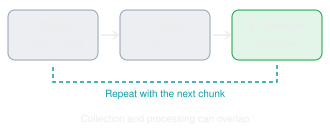
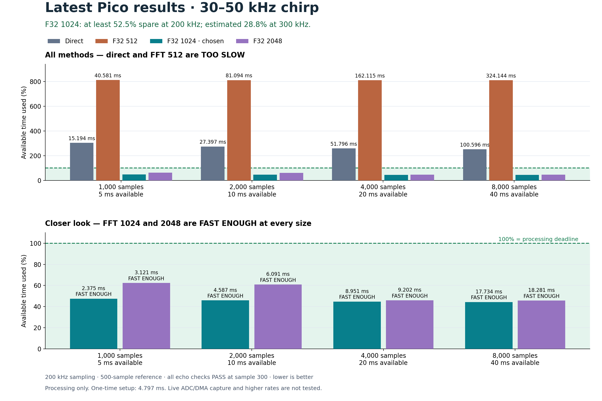

# Ultrasonic benchmark

## Context

We're looking for the best balance of:

1. **Buffer size:** how many samples we process at once.
2. **Processing speed:** how quickly the Pico finds the echo.
3. **Latency:** how long we wait for an echo result, and eventually a distance.

**Goal:** finish processing each sample buffer before the next one fills, with
time to spare. Larger buffers raise throughput but take longer to fill, so
results arrive later and the sensor feels less responsive.

> **Measured:** processing time only.
> **Not yet built:** ADC/DMA input, full sensor-to-result latency, distance.

### What we tested

|             |                                                                                                                                   |
| ----------- | --------------------------------------------------------------------------------------------------------------------------------- |
| Buffers     | 1,000 / 2,000 / 4,000 / 8,000 samples                                                                                             |
| Methods     | Manual (direct) comparison, CMSIS direct correlation, F32 FFT, Q15 FFT (removed)                                                  |
| FFT sizes   | 512, 1024, 2048                                                                                                                   |
| Speed       | Processing time, throughput, spare time before the next buffer                                                                    |
| Correctness | 500-sample, 30–50 kHz pattern with a known 300-sample delay; weak/noisy signals, echoes near buffer edges, zero input, bad inputs |
| Build       | Release `-O3`; reference FFT prepared once and reused                                                                             |

### Why 200 kHz

The test chirp sweeps **30–50 kHz**, centered at **40 kHz** (±10 kHz).
At 200 kHz we get five samples per cycle at 40 kHz, and four at 50 kHz.
That is enough to sample this band and leaves processing time for other work;
500 kHz is not needed for the current test. Real input will need filtering
before the ADC to keep frequencies at or above 100 kHz out.

### Planned capture flow (not implemented)



Will include double-buffered ADC/DMA: process one buffer while the next fills.

## Result: F32 FFT 1024

The main app uses **F32 FFT, size 1024**. It was the fastest method tested, found the correct echo delay, and met the 200 kHz budget at every buffer size.



Dashed line = time available at 200 kHz. Below it is fast enough.

| Samples |     Direct | **F32 FFT 1024** | Q15 FFT 1024 (removed) | Budget @ 200 kHz |
| ------: | ---------: | ---------------: | ---------------------: | ---------------: |
|   1,000 |  15.191 ms |     **2.284 ms** |               6.051 ms |             5 ms |
|   2,000 |  27.388 ms |     **4.448 ms** |               7.777 ms |            10 ms |
|   4,000 |  51.774 ms |     **8.763 ms** |              11.225 ms |            20 ms |
|   8,000 | 100.548 ms |    **17.377 ms** |              18.102 ms |            40 ms |

- Direct misses the budget at every size; Q15 misses it at 1,000 samples.
- At 8,000 samples: 17.377 ms of a 40 ms budget → **22.6 ms spare**,
  ~460,000 samples/s throughput.
- These are earlier Pico measurements, not timings of the new 30–50 kHz test, and their
  sample-rate setting wasn't recorded. All methods found the expected **300-sample delay**. Setup and sensor input are excluded; continuous capture is untested.

## How high can we go?

| Rate        | Min spare time (F32) | Verdict                          |
| ----------- | -------------------: | -------------------------------- |
| **200 kHz** |              **54%** | Start here.                      |
| 300 kHz     |                  31% | Next test once live input works. |
| 400 kHz     |                   8% | Too tight.                       |
| ~438 kHz    |                  ~0% | Math-only limit.                 |

Estimates from the slowest per-sample result across all buffer sizes,
excluding sensor input and DMA. 300 kHz and up have not been tested with live
capture.

## Run the benchmark

After [setting up the build](../README.md#build):

```sh
cmake --build build --target ultrasonic_benchmark -j 8
```

[Upload](../README.md#upload) `build/ultrasonic_benchmark.uf2` and open serial
at **115200 baud**. It reruns every 5 s, averages 5 runs per measurement, and
compares 512/1024/2048-point F32 FFTs against direct. Setup runs once before
timing. (The chart above shows the older saved data.)

| Output            | Meaning                                          |
| ----------------- | ------------------------------------------------ |
| `ms`              | Processing time (lower is better)                |
| `x`               | Speedup vs. direct (higher is better)            |
| `peak 300`        | Echo found at the expected sample 300            |
| `max error`       | Largest difference from direct (lower is better) |
| `PASS`            | Correct delay and error < 0.002                  |
| `FAST ENOUGH`     | Finishes within the sample-collection time       |
| `1024 production` | Same function the main app uses                  |

**Redraw the chart:** install Matplotlib and NumPy, then run
`python3 benchmarks/plot_results.py` (saves PNG and SVG to `benchmarks/images/`).

[Math checks](RESULTS.md) · [Computer tests](../tests/README.md)
